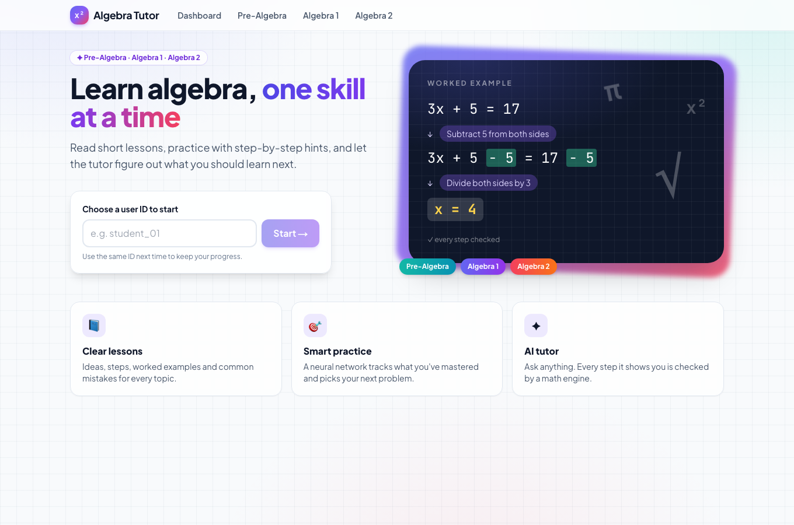
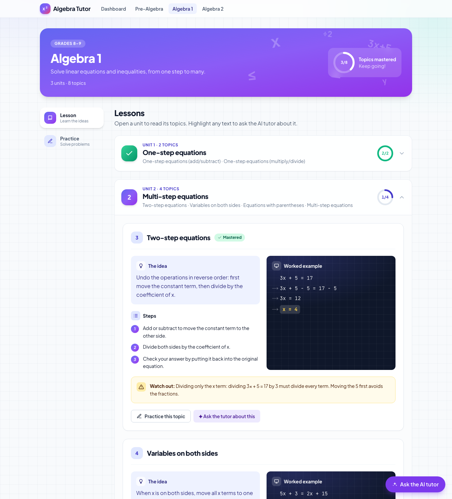
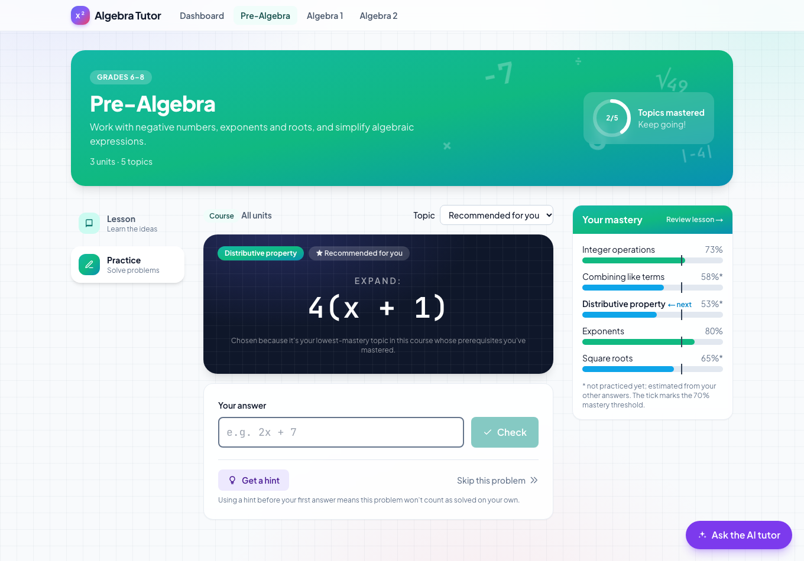
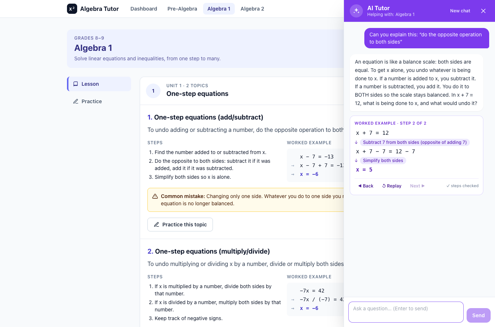
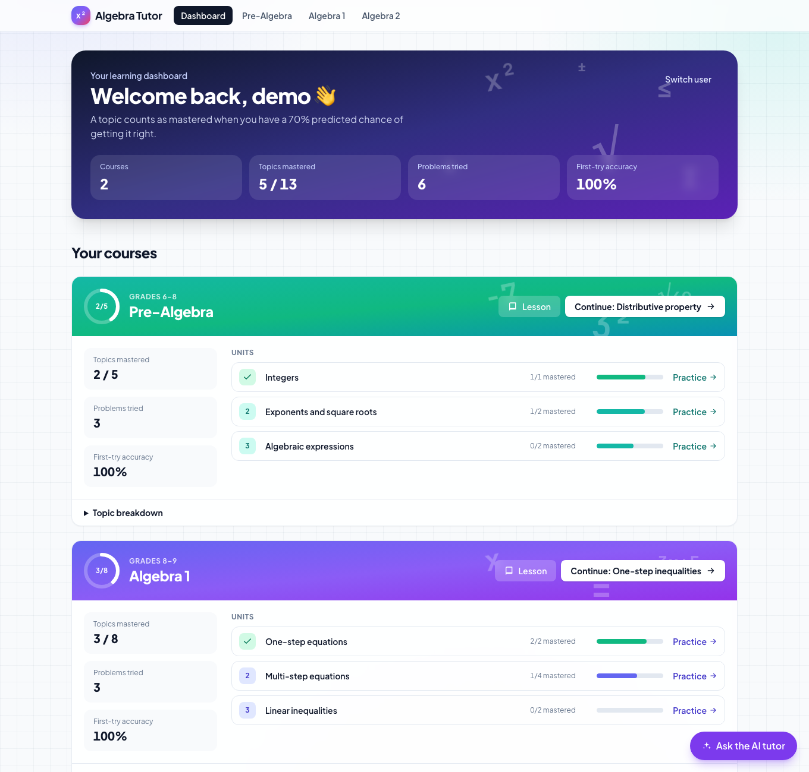
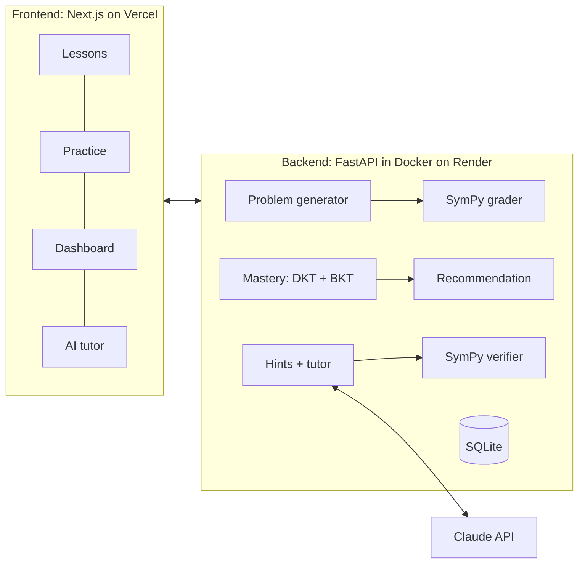

# AI Algebra Tutor

An adaptive algebra learning platform. A deep knowledge tracing model estimates what each
student has mastered, the system recommends the next problem, and an AI tutor explains
step by step, with **every math step verified by a computer algebra system (SymPy) before
the student sees it**.

MSCS capstone project by **Mingqi Zhao** · Advisor: **Bolei Zhou** · 2026

**Live demo:** https://ai-algebra-tutor-pi.vercel.app (the free backend sleeps when idle;
the first request can take about a minute) · **Report:** [`report/report.md`](report/report.md)



---

## What it does

| | |
|---|---|
| **3 courses, 8 units, 18 topics** | Pre-Algebra, Algebra 1, Algebra 2: integers, exponents and roots, expressions, linear equations, inequalities, polynomials, quadratic equations |
| **Lessons** | Every topic has the idea, steps, a worked example and a common mistake. Every worked-example line is checked with SymPy in the tests. |
| **Adaptive practice** | Unlimited template-generated problems, graded by SymPy (any equivalent form is accepted; you're told when an answer isn't simplified). |
| **Mastery tracking** | A DKT model (LSTM) trained on real student data estimates mastery per topic; topics without training data use BKT. |
| **Recommendation** | The lowest-mastery topic whose prerequisites are mastered (70% threshold). |
| **Verified hints** | Claude proposes one next step; SymPy checks that it is equivalent, makes progress and doesn't reveal the answer, retrying up to 3 times. |
| **AI tutor** | Ask by typing, by highlighting any text, or with “Explain this unit”. Replies include an animated worked example whose every step is verified. It never gives the answer to the problem on screen. |
| **Dashboard** | Joined courses, unit progress, and a topic breakdown by prerequisite level. |

| Lesson | Practice |
|---|---|
|  |  |
| **AI tutor with a verified walkthrough** | **Dashboard** |
|  |  |

## Results

| Experiment | Result |
|---|---|
| **1. Knowledge tracing** (ASSISTments 2009, 4,027 students, split by student) | Test AUC: **DKT 0.751** vs BKT 0.708 |
| **2. Hint verification** (127 hints, paired, manually audited) | Claude Haiku answer leaks: **7.9% → 0%** with the SymPy check, at 1.11 calls per hint. Claude Opus was already almost always correct. |
| **3. Tutor walkthroughs** (40 requests, all 8 units) | 100% of shown walkthroughs fully verified, 0 answer leaks, 3.4 s per reply |

Full logs: [`experiments/results.md`](experiments/results.md) · audit: [`experiments/hint_audit.md`](experiments/hint_audit.md)

**Limitations:** SymPy verifies math, not wording; the topic-to-ASSISTments skill mapping
is approximate; BKT parameters for Algebra 2 topics are hand-set; learning gains with real
students were not measured. See the report, section 7.

## Architecture



## Repository layout

| Path | Contents |
|---|---|
| `ml/` | Preprocessing, DKT (PyTorch) and BKT (pyBKT) training, shared evaluation |
| `backend/app/` | API (`main.py`), skills and courses, generator, grader, mastery, recommendation, hints, tutor |
| `backend/tests/` | 291 pytest tests |
| `frontend/` | Next.js + Tailwind web app |
| `experiments/` | Experiment scripts, `results.md`, raw outputs, audit |
| `report/` | Capstone report |
| `DEPLOY.md` | Deployment guide (Render + Vercel) |

## Run it locally

Requirements: Python 3.11, Node 20.

```bash
# backend
python3.11 -m venv .venv
.venv/bin/pip install -r ml/requirements.txt -r backend/requirements.txt
cp .env.example .env            # add ANTHROPIC_API_KEY for hints and the AI tutor
.venv/bin/uvicorn backend.app.main:app --reload        # http://localhost:8000/docs

# frontend (second terminal)
cd frontend && npm install && npm run dev               # http://localhost:3000
```

The trained DKT weights are included (`ml/checkpoints/dkt.pt`). Retraining requires the
ASSISTments 2009 skill-builder file in `data/raw/` (not included), then:

```bash
.venv/bin/python ml/preprocess.py
.venv/bin/python -m ml.train_dkt
.venv/bin/python -m ml.train_bkt
```

## Tests and experiments

```bash
cd backend && ../.venv/bin/python -m pytest -q                        # 291 tests
.venv/bin/python experiments/hint_experiment.py --fake                # free dry run
.venv/bin/python experiments/hint_experiment.py --per-skill 10        # experiment 2 (uses API credit)
.venv/bin/python experiments/tutor_experiment.py                      # experiment 3 (uses API credit)
```

## Tech stack

Python · PyTorch · pyBKT · scikit-learn · SymPy · FastAPI · SQLite · Claude API
(structured outputs) · Next.js 14 · TypeScript · Tailwind CSS · Docker · Render · Vercel
