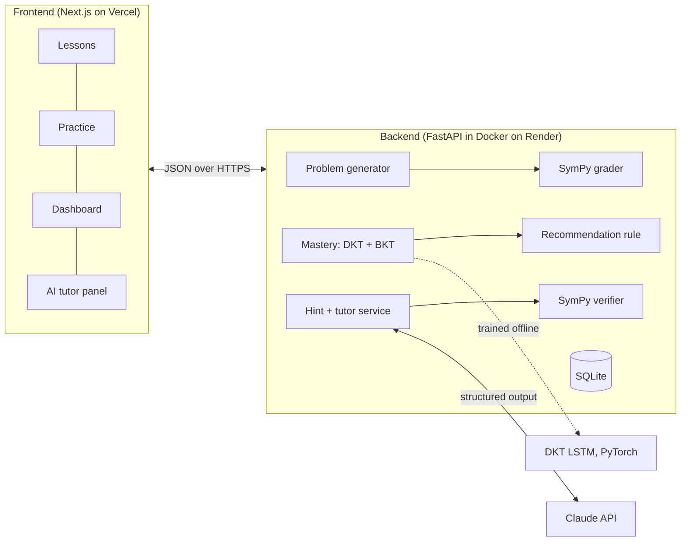

# AI Algebra Tutor: Adaptive Practice with Deep Knowledge Tracing and Verified LLM Feedback

**MSCS Capstone Report** · TODO: your name · TODO: advisor · TODO: date

> Draft written from the repository on 2026-11-14. Every number below comes from
> `experiments/results.md` or `data/processed/stats.json`. Sections marked **TODO**
> need your input. Rewrite the text in your own words before submitting.

---

## Abstract

Students learning algebra benefit from practice that adapts to what they already know
and from help at the exact step where they are stuck. Large language models (LLMs) can
explain mathematics fluently, but they also make errors and readily reveal answers, two
failure modes that are particularly harmful in a tutoring setting. This project builds an
adaptive algebra tutor that combines (1) a Deep Knowledge Tracing (DKT) model that
estimates each student's mastery of each skill, (2) a prerequisite-aware recommendation
rule that selects the next problem, and (3) LLM-generated hints and tutor explanations
whose every mathematical step is verified with a computer algebra system (SymPy) before
it is shown. On the ASSISTments 2009 dataset, split by student, DKT reaches a test AUC of
0.751 versus 0.708 for a Bayesian Knowledge Tracing (BKT) baseline. In a paired experiment
on 127 hint requests, verification reduced the answer-leak rate of a smaller LLM from
7.9% to 0% at a cost of 1.11 model calls per hint; a stronger LLM rarely needed
correction. In 40 tutor requests across eight units, every animated worked example shown
to students was fully verified and none revealed the answer to the student's current
problem. The system is deployed as a web platform with three courses (Pre-Algebra,
Algebra 1, Algebra 2), 8 units and 18 topics.

---

## 1. Introduction

### 1.1 Motivation
Practice is most useful when it targets what a student has not yet mastered, and help is
most useful when it addresses the step a student is stuck on. Classroom teachers cannot
provide either for every student at once. Intelligent tutoring systems have long tried to
fill this gap with knowledge tracing (estimating mastery from answer histories) and with
step-level feedback.

LLMs make natural-language explanations cheap, but they introduce two risks for tutoring:
- **Incorrect mathematics.** A fluent but wrong step can teach a misconception.
- **Answer leakage.** A tutor that simply gives the answer removes the learning opportunity.

### 1.2 Research questions
- **RQ1.** Does a deep knowledge tracing model predict student performance better than the
  classic BKT baseline on held-out students?
- **RQ2.** How often do LLM-generated step hints contain mathematical errors or reveal the
  answer, and how much does verification with a computer algebra system reduce this, at
  what cost?
- **RQ3.** Can multi-step, animated LLM explanations be verified in the same way, and how
  often do they pass?

### 1.3 Contributions
1. A complete, deployed adaptive tutor for introductory algebra: template-generated
   problems, SymPy grading, DKT-based mastery, prerequisite-aware recommendation, lessons,
   and a dashboard.
2. A verification layer for LLM output in tutoring. Each proposed step is checked for
   mathematical equivalence, progress, and answer leakage, with feedback-driven retries and
   safe fallbacks. It is applied both to one-step hints and to multi-step tutor walkthroughs.
3. Three experiments: DKT vs BKT (RQ1), hint verification with two LLMs including a manual
   audit (RQ2), and tutor walkthrough verification (RQ3).

---

## 2. Background and related work

> **TODO:** verify every citation against the original paper and add 2–4 recent papers on
> LLM tutoring and LLM math errors that your program expects. Do not cite anything you
> have not read.

- **Bayesian Knowledge Tracing (BKT)** models each skill as a hidden binary state
  (learned / not learned) with four parameters: prior, learn, guess, slip (Corbett &
  Anderson, 1994). We use the pyBKT library (Badrinath, Wang & Pardos, 2021).
- **Deep Knowledge Tracing (DKT)** replaces the per-skill HMM with a recurrent network over
  the whole interaction sequence, which lets it learn relationships between skills
  (Piech et al., 2015). Attention-based variants such as SAKT (Pandey & Karypis, 2019)
  were listed as optional in this project and were not implemented.
- **ASSISTments** is an online math-practice platform whose 2009–2010 skill-builder data
  is a standard knowledge tracing benchmark (Feng, Heffernan & Koedinger, 2009).
- **SymPy** is an open-source computer algebra system in Python (Meurer et al., 2017),
  used here for grading and verification.
- **LLMs in tutoring.** TODO: summarize work on LLM tutors and their errors / answer leakage.

---

## 3. System design

### 3.1 Overview

| Layer | Technology | Responsibility |
|---|---|---|
| Frontend | Next.js 14, Tailwind | Courses, lessons, practice, dashboard, tutor chat |
| Backend | FastAPI, SQLite | Problems, grading, mastery, recommendation, hints, tutor |
| ML | PyTorch (DKT), pyBKT (baseline) | Knowledge tracing |
| Math | SymPy | Grading and verification of every LLM step |
| LLM | Claude (Opus 5.5 by default) | Hints and tutor explanations, as structured JSON |
| Deployment | Vercel, Docker on Render | Public web app |

TODO: add 3–4 screenshots (lesson page, practice page with hint, tutor walkthrough, dashboard).

### 3.2 Curriculum and skill graph
The platform has three courses, 8 units and 18 topics (skills), each with prerequisites:

| Course | Units (topics) |
|---|---|
| Pre-Algebra | Integers (1) · Exponents and square roots (2) · Algebraic expressions (2) |
| Algebra 1 | One-step equations (2) · Multi-step equations (4) · Linear inequalities (2) |
| Algebra 2 | Polynomials (2) · Quadratic equations (3) |

Prerequisites form a directed acyclic graph (checked by a test). Every topic has a lesson
with an idea, steps, a worked example and a common mistake. **Every line of every worked
example is verified with SymPy in the test suite**, so a lesson cannot silently teach an
incorrect step.

### 3.3 Problem generation and grading
Each topic has a template generator. Problems are generated "answer first" (for example,
pick the solution x, then build the equation around it), so answers are always integers,
and a problem is fully determined by `skill:seed`. The server therefore regenerates a
problem from its id to grade it and never sends the answer to the browser.

The grader parses answers with SymPy and checks:
1. **Equivalence:** the same value, or the same solution set (any order) for quadratics
   and inequalities.
2. **Simplest form:** judged on the *unevaluated* parse, so `x = 8/2` is marked "right
   value, not simplified".
3. **Targeted feedback,** for example "that's one solution, but there's another one", or
   "right boundary, check the direction of the inequality sign".

**Security.** SymPy's parser uses `eval`, so student text is restricted to a character
whitelist, a length cap, `sqrt(` as the only word, and exponents of at most 4 that cannot be
chained (which blocks inputs like `9^9^9`).

### 3.4 Knowledge tracing in the live system
DKT was trained on ASSISTments skills, not on our topics, so each topic is mapped to one
or more ASSISTments skills. A topic's answers are fed to the LSTM as its first mapped
skill, and its mastery is the mean predicted P(correct) over its mapped skills. We only
map to ASSISTments skills with at least 1,000 training rows (enforced by a test); the
closest-named skills for "Algebraic Simplification" (84 rows) and "Distributive Property"
(10 rows) failed this rule and were replaced by related, well-trained skills.

Inequalities, polynomials and quadratics have essentially no ASSISTments data (for
example, 26 rows for the quadratic formula). For these 7 topics the system uses **BKT with
hand-set parameters** (prior 0.1, learn 0.1, guess 0.25, slip 0.1), reporting P(correct on
the next attempt) so that the 0.7 mastery threshold means the same thing for both models.
With these settings, two correct first attempts in a row reach mastery.

Only each problem's **first graded attempt** updates mastery, matching how ASSISTments
defines correctness; requesting a hint before answering makes the attempt count as
incorrect.

### 3.5 Recommendation rule
Recommend the lowest-mastery topic whose prerequisites are all mastered (≥ 0.7). Ties go
to the more basic topic (topological order). Within a course or unit, only prerequisites
inside that course or unit gate a topic, so a student can start Algebra 1 directly.

### 3.6 Verified LLM hints
A hint is a JSON object `{hint, next_step}` produced with Claude's structured output.
Before a student sees it, `next_step` must:
1. parse safely;
2. be equivalent to the student's current step (same solution set);
3. make progress, judged on the written form, because distributing changes the form but
   not the value;
4. not be the final answer.

The hint text is also scanned for the answer. Rejected hints are retried with the reasons
(at most 3 attempts), then replaced by a fixed, safe hint for the skill.

### 3.7 The AI tutor
A chat panel follows the student across the site. Students can type a question, highlight
text on the page, or ask for a whole unit to be explained. A reply has a short message and
an optional **walkthrough** (a starting expression and a list of `{operation, result}`
steps), which the frontend animates line by line, highlighting what was added or removed
and flagging inequality sign flips.

Each step must be equivalent to the starting line. Substitute-back "check" steps with no
x, such as `-7(8) + 4 = -52`, are allowed if they are true. When a practice problem is on
screen, the tutor is given a similar problem with different numbers to use instead, and
any reply whose message states the answer, or whose example has the same solution set,
is rejected. Unverifiable walkthroughs are dropped (text only), and the tutor is
rate-limited (30 messages per user per hour, 300 in total) because every message costs
API credit.

---

## 4. Data

ASSISTments 2009–2010 skill-builder data (`data/processed/stats.json`):

| Step | Rows | Students |
|---|---|---|
| Raw file | 525,534 | 4,217 |
| Drop rows without a skill | 459,208 | |
| One row per answer (deduplicate `order_id`) | 283,105 | |
| Students with ≥ 2 answers | 282,969 | 4,027 |

The deduplication step matters. The raw file repeats an answer once per tagged skill, and
keeping those copies would let a sequence model see the answer it is about to predict,
inflating AUC. After cleaning there are 112 skills. Students (not rows) are split
70/15/15 into train (2,818 students, 201,797 rows), validation (604, 44,778) and test
(605, 36,394), so no student appears in more than one split. All seeds are fixed at 42.

---

## 5. Experiments and results

### 5.1 Experiment 1: DKT vs BKT (RQ1)
**Setup.** DKT: an embedding of (skill, correct) tokens (size 100), an LSTM (hidden size
100), dropout 0.2, Adam (lr 1e-3), batch size 64, training windows of 200 answers, gradient
clipping at 1.0, and early stopping on validation AUC (patience 3, at most 30 epochs).
Evaluation runs on full sequences. BKT: pyBKT 1.4.3, one model per skill, 5 random restarts.
Both models predict every answer except each student's first, and are scored identically
(`ml/evaluation.py`).

| Model | Val AUC | Val ACC | Test AUC | Test ACC |
|---|---|---|---|---|
| BKT (pyBKT) | 0.716 | 0.721 | 0.708 | 0.708 |
| **DKT (LSTM)** | **0.755** | **0.739** | **0.751** | **0.731** |

Test predictions: n = 35,789. **DKT improves test AUC by 0.043 over BKT**, consistent with
DKT's ability to share information across skills.

### 5.2 Experiment 2: Verified hints (RQ2)
**Setup.** 127 hint requests: 10 problems per skill for the 9 linear-equation skills, plus
the real "last step" (cx = d) for equation problems, where leaking is most tempting. The
design is **paired**: the LLM's first proposal is exactly what an unverified system would
show, and the verified system's final output is what students see. Both are scored on the
same outputs. Leaks are measured by the checker and by a broad "answer value appears
anywhere" measure, which was then **manually audited** (`experiments/hint_audit.md`).

| Model | Condition | Math errors | Leaks (audited) | Wrong prose found* | LLM calls / hint |
|---|---|---|---|---|---|
| Claude Opus 5.5 | without check | 0% | 0.8% (1) | 0 | 1 |
| Claude Opus 5.5 | with check | 0% | 0.8% (1) | 0 | 1.0 |
| Claude Haiku 5.5 | without check | 0% | 7.9% (10) + 1 borderline | 2 | 1 |
| Claude Haiku 5.5 | with check | 0% | **0%** + 1 borderline | 2 | 1.11 |

\*Only broad-flagged hints were audited for wrong prose, so this is a lower bound.

**Findings.**
- Verification removed every detectable leak from the weaker model for 11% extra calls.
- The stronger model rarely needed it.
- SymPy cannot check wording. The one Opus leak was in prose ("0 divided by any nonzero
  number is 0" when x = 0), and Haiku twice called a correct student step wrong.
- The experiment also surfaced three bugs in our own pipeline: a progress check that
  rejected correct distribution steps, a leak check that read `8x = 0` as `x = 0`, and an
  initial design whose "last step" states were unreachable from the problem. The first run
  is kept in the log, marked invalid.

### 5.3 Experiment 3: Verified tutor walkthroughs (RQ3)
**Setup.** 40 tutor requests: for each of the 8 units, three "explain this unit" requests
and two "just tell me the answer" requests made while a practice problem was on screen.
The design is paired as in Experiment 2.

| Measure | Result |
|---|---|
| First replies with a walkthrough | 100% |
| First-reply math errors (after the checker fix) | 0% |
| First-reply answer leaks | 0% |
| Shown with a fully verified walkthrough | 100% |
| LLM calls per request / latency | 1.05 / 3.4 s |
| Cost (40 requests, Opus 5.5) | $0.45 |

**Finding.** The initial run reported 5% "math errors". Inspection showed both cases were
correct substitute-back checks that the verifier wrongly rejected. After the verifier was
fixed, both runs are reported. This illustrates a general point: a verifier is a model of
validity, and its false positives cost pedagogical quality, here a useful "check your
answer" step.

---

## 6. Engineering and testing

- **Tests:** 291 automated backend tests (pytest) cover the grader (including security
  inputs), generators (300 seeds per skill, each verified by SymPy), lessons (every worked
  example line), recommendation, BKT, mastery routing, hints, the tutor and the API.
- **Reproducibility:** fixed seeds, by-student splits, every experiment logged in
  `experiments/results.md` together with its raw outputs.
- **Deployment:** Docker image with CPU-only PyTorch on Render, Next.js on Vercel, CORS
  restricted to the site, and the API key held only in server environment variables.
- **End-to-end checks:** an automated headless-browser walkthrough of the live site
  (sign-in, lessons, practice, hints, tutor, dashboard, phone width).

---

## 7. Limitations

1. **Approximate skill mapping.** Tutor topics are mapped onto ASSISTments skills by hand.
   Several topics share one ASSISTments skill, so their mastery estimates move together.
2. **Hand-set BKT parameters** for 7 topics with no training data.
3. **Verification covers math, not language.** Misleading wording can pass.
4. **No learning-outcome evaluation.** Experiments measure prediction accuracy and output
   safety, not whether students learn more; a user study was out of scope.
5. **Small LLM experiments** (127 hints and 40 tutor requests) and a single-annotator
   manual audit.
6. **Infrastructure.** The free hosting tier sleeps when idle and resets the SQLite
   database on restart.

## 8. Future work
- A classroom or user study measuring learning gains and how students use the tutor.
- Training knowledge tracing on data that covers Algebra 2 topics, or fitting BKT
  parameters from the platform's own logs.
- Checking the explanation text, for example by extracting and verifying every equation
  in the prose.
- Attention-based knowledge tracing (SAKT), which was optional in the original plan.
- Persistent storage (Postgres) for real deployments.

## 9. Conclusion
TODO (3–5 sentences, your own words): what you built, the answer to each RQ, and the main
lesson. Suggested lesson: "LLMs are useful tutors when their mathematical claims are
verified, but the verifier itself must be tested, because both its misses and its false
alarms affect students."

## 10. Reflection
TODO (your own words): what was hardest, what you would do differently, the scope changes
you made (course platform, AI tutor), and why.

---

## References

> TODO: check every entry and format it in your program's required citation style.

- Badrinath, A., Wang, F., & Pardos, Z. (2021). pyBKT: An accessible Python library of Bayesian Knowledge Tracing models. *Proceedings of the 14th International Conference on Educational Data Mining.*
- Corbett, A. T., & Anderson, J. R. (1994). Knowledge tracing: Modeling the acquisition of procedural knowledge. *User Modeling and User-Adapted Interaction, 4*(4), 253–278.
- Feng, M., Heffernan, N., & Koedinger, K. (2009). Addressing the assessment challenge with an online system that tutors as it assesses. *User Modeling and User-Adapted Interaction, 19*(3), 243–266.
- Meurer, A., et al. (2017). SymPy: Symbolic computing in Python. *PeerJ Computer Science, 3*, e103.
- Pandey, S., & Karypis, G. (2019). A self-attentive model for knowledge tracing. *Proceedings of the 12th International Conference on Educational Data Mining.*
- Piech, C., Bassen, J., Huang, J., Ganguli, S., Sahami, M., Guibas, L., & Sohl-Dickstein, J. (2015). Deep knowledge tracing. *Advances in Neural Information Processing Systems 28.*

---

## Appendix: where things are in the repository

| Item | Path |
|---|---|
| Preprocessing, DKT, BKT, evaluation | `ml/` |
| Skills, courses and lessons, generator, grader | `backend/app/skills.py`, `courses.py`, `problems.py`, `grader.py` |
| Mastery (DKT + BKT), recommendation | `backend/app/mastery.py`, `bkt.py`, `recommend.py` |
| Hints, tutor, API | `backend/app/hints.py`, `tutor.py`, `main.py` |
| Experiments and logs | `experiments/` (`results.md`, `hint_audit.md`, raw `.jsonl`) |
| Frontend | `frontend/` |
| Deployment | `backend/Dockerfile`, `render.yaml`, `DEPLOY.md` |
